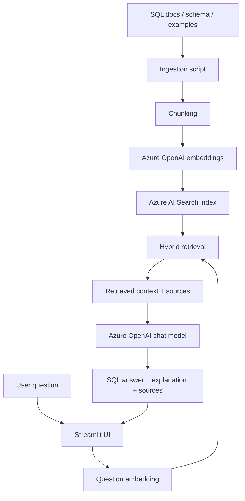

# AI-Powered SQL Assistant (RAG)

A portfolio-ready RAG application that answers SQL questions using your own SQL documentation, schema notes and examples.

**Stack:** Python · Streamlit · Azure AI Search · Azure OpenAI · Embeddings · Hybrid/vector search

## Features
- Ingest Markdown, TXT, SQL and CSV knowledge files.
- Split documents into overlapping chunks.
- Generate embeddings with Azure OpenAI.
- Store chunks, source metadata and vectors in Azure AI Search.
- Retrieve context using hybrid keyword + vector search.
- Generate SQL and explanations with source references.
- Generate SQL text only; this starter does not execute database queries.

## Architecture



## Prerequisites
- Python 3.10+
- Azure AI Search service
- Azure OpenAI resource with one chat deployment and one embedding deployment
- Resource endpoints, keys and deployment names

Azure resources can incur charges. Check your subscription, region, quota and pricing before creating resources.

## Setup

```bash
git clone https://github.com/YOUR-USERNAME/ai-powered-sql-assistant-rag.git
cd ai-powered-sql-assistant-rag
python -m venv .venv
# Windows: .venv\\Scripts\\activate
# macOS/Linux: source .venv/bin/activate
pip install -r requirements.txt
cp .env.example .env
```

Fill `.env` with your own Azure values. Deployment names are the names you assigned in Azure, not necessarily the base model names. Never commit `.env` or API keys.

| Variable | Meaning |
|---|---|
| AZURE_OPENAI_ENDPOINT | Azure OpenAI endpoint |
| AZURE_OPENAI_API_KEY | Azure OpenAI key |
| AZURE_OPENAI_API_VERSION | API version enabled for your resource |
| AZURE_OPENAI_CHAT_DEPLOYMENT | Chat model deployment name |
| AZURE_OPENAI_EMBEDDING_DEPLOYMENT | Embedding deployment name |
| EMBEDDING_DIMENSIONS | Must match embedding output |
| AZURE_SEARCH_ENDPOINT | Azure AI Search endpoint |
| AZURE_SEARCH_API_KEY | Search admin key for this learning project |
| AZURE_SEARCH_INDEX_NAME | Index name |

## Create index, ingest and run

```bash
python scripts/create_search_index.py
python scripts/ingest_documents.py
streamlit run app.py
```

Starter knowledge files are in `data/knowledge_base/`. Add safe, non-confidential `.md`, `.txt`, `.sql` or `.csv` documents and rerun ingestion.

Try:
- Write a query to find the top 5 customers by revenue.
- Explain ROW_NUMBER, RANK and DENSE_RANK.
- Calculate month-over-month revenue growth.
- Which tables and join keys are in the sample schema?

## Tests

```bash
python -m pytest
```

## Suggested repository structure

```text
├── app.py
├── requirements.txt
├── .env.example
├── .gitignore
├── README.md
├── src/
│   ├── config.py
│   ├── azure_clients.py
│   ├── chunking.py
│   ├── prompts.py
│   └── rag.py
├── scripts/
│   ├── create_search_index.py
│   └── ingest_documents.py
├── data/knowledge_base/
│   ├── sql_window_functions.md
│   ├── sales_schema.md
│   └── sql_examples.sql
└── tests/test_chunking.py
```

## Screenshots to add after running
1. Chat UI showing a SQL question and answer.
2. Expanded retrieved-source panel.
3. Azure AI Search index fields showing the vector field.
4. Successful ingestion terminal output.
5. Architecture diagram.

Do not fabricate screenshots or claim a live deployment before it exists.

## Advanced roadmap
- [ ] Upload and ingest documents from an admin panel.
- [ ] Add metadata filters for dialect, topic and document type.
- [ ] Add semantic reranking and compare retrieval quality.
- [ ] Create evaluation questions and expected source documents.
- [ ] Measure retrieval precision/recall and answer faithfulness.
- [ ] Add conversation-aware follow-up questions.
- [ ] Use Entra ID / managed identity instead of API keys.
- [ ] Add GitHub Actions CI, Docker and deployment.
- [ ] Add a read-only SQL sandbox only after strict security controls.

## Security
- Treat retrieved documents as untrusted reference content, not instructions.
- Never upload employer, customer, personal or confidential information.
- Never expose keys in code, screenshots or logs.
- Review generated SQL before running it.
- If execution is added later, use a dedicated read-only account, allowlisted schemas, query timeouts, row limits and isolation.

## Official learning references
- [Azure AI Search vector search](https://learn.microsoft.com/azure/search/search-get-started-vector)
- [Azure AI Search integrated vectorization](https://learn.microsoft.com/azure/search/vector-search-integrated-vectorization)
- [Azure OpenAI chat completions](https://learn.microsoft.com/azure/ai-services/openai/how-to/chatgpt)
- [Streamlit chat elements](https://docs.streamlit.io/develop/api-reference/chat)

## Portfolio description
Built a Python and Streamlit SQL assistant using Azure OpenAI embeddings and Azure AI Search hybrid retrieval to ground SQL generation and explanations in a curated knowledge base. Implemented document chunking, vector indexing, retrieval, source attribution and guarded prompting. The application generates SQL for review and does not execute queries against a live database.
